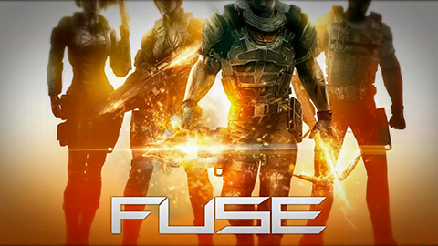

# FuseRecomp

<div align="center">
  
</div>

A static recompilation of [**FUSE**](https://en.wikipedia.org/wiki/Fuse_(video_game)) (Insomniac Games, 2013, Xbox 360) to native x86-64 for Windows and Linux, built on the [ReXGlue SDK](https://github.com/rexglue/rexglue-sdk).

> This project is not affiliated with Microsoft, Insomniac Games or Electronic Arts. It contains no game files: you need your own legally owned copy of the game.

## Status

**Playable offline**: video, audio, gameplay, achievements and saves work. Online features are not supported.

## Required game copy

Retail Xbox 360 disc of **FUSE**, this exact release (addresses are hardcoded):

| | |
|---|---|
| Title ID | `4541096E` (EA-2414) |
| Media ID | `566B2842` |
| `default.xex` hash | `34AD8CB8A7A6A172` |

Dump your disc to an ISO, extract it with [extract-xiso](https://github.com/XboxDev/extract-xiso/releases) (`extract-xiso -x FUSE.iso`) and copy the contents into `assets/` (gitignored), so that `assets/default.xex` exists.

## Build and run

Requires CMake 3.25+, Ninja and Clang/LLVM (clang-cl works too). The SDK is built from the submodule.

```bash
git clone --recurse-submodules <repo-url>
cmake --preset win-amd64-relwithdebinfo        # or linux-amd64-relwithdebinfo
cmake --build out/build/win-amd64-relwithdebinfo
out/build/win-amd64-relwithdebinfo/fuserecomp.exe
```

Logs go to `out/build/<preset>/logs/`.

## Configuration

`settings/hardware.toml` (rendering, performance, game patches, language) and `settings/mapping.toml` (input) load automatically; CLI flags and `REX_*` environment variables override them. See [`settings/README.md`](settings/README.md).

## Credits

[ReXGlue SDK](https://github.com/rexglue/rexglue-sdk) · [xenia](https://github.com/xenia-project/xenia) / [xenia-canary](https://github.com/xenia-canary/xenia-canary) (incl. the [Fuse game patches](https://github.com/xenia-canary/game-patches)) · [extract-xiso](https://github.com/XboxDev/extract-xiso)
