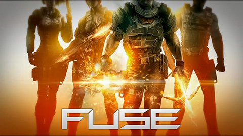

# FuseRecomp

<div align="center">
  
</div>

A static recompilation of [**FUSE**](https://en.wikipedia.org/wiki/Fuse_(video_game)) (Insomniac Games, 2013, Xbox 360) to native x86-64 for Windows and Linux, built on the [ReXGlue SDK](https://github.com/rexglue/rexglue-sdk).

> This project is not affiliated with Microsoft, Insomniac Games or Electronic Arts. It contains no game files: you need your own legally owned copy of the game.

## Status

**Playable offline**: video, audio, gameplay, achievements and saves work. Online features are not supported.

## Required game copy

Retail Xbox 360 disc of **FUSE**, this exact release (addresses are hardcoded):

| | |
|---|---|
| Title ID | `4541096E` (EA-2414) |
| Media ID | `566B2842` |
| `default.xex` hash | `34AD8CB8A7A6A172` |

Dump your disc to an ISO, extract it with [extract-xiso](https://github.com/XboxDev/extract-xiso/releases) (`extract-xiso -x FUSE.iso`) and copy the contents into `assets/` (gitignored), so that `assets/default.xex` exists.

## Build and run

Requires CMake 3.25+, Ninja and Clang/LLVM (clang-cl works too). The SDK is built from the submodule.

```bash
git clone --recurse-submodules <repo-url>
cmake --preset win-amd64-relwithdebinfo        # or linux-amd64-relwithdebinfo
cmake --build out/build/win-amd64-relwithdebinfo
out/build/win-amd64-relwithdebinfo/fuserecomp_launcher.exe   # or fuserecomp.exe directly
```

Logs go to `out/build/<preset>/logs/`.

### Launcher

`fuserecomp_launcher` is built next to the game (SDK launcher, page from [`launcher/launcher.toml`](launcher/launcher.toml)): pick the main settings, press Play. It edits `settings/hardware.toml` and `settings/mapping.toml` in place, so starting `fuserecomp` directly uses the same settings. Fuse's own page: 60 FPS, skip intro, texture streaming fix, package cache, field of view, mouse look and GPU wait. If the game crashes, it reopens with **Safe mode** (emulated renderer on Vulkan, scale 1, no upscaler or AA, settings files untouched). Format: [`launcher.md`](thirdparty/rexglue-sdk/docs/launcher.md).

## Configuration

`settings/hardware.toml` (rendering, performance, game patches, language, split-screen players) and `settings/mapping.toml` (input) load automatically; CLI flags and `REX_*` environment variables override them. See [`settings/README.md`](settings/README.md); every SDK graphics option is described in [`settings/faq.md`](settings/faq.md).

Renderers (`gpu_plugin`): **native** (`rexgpu-native`, checked-in default) draws the game's commands directly with Vulkan, without emulating the EDRAM: faster on the GPU, early (fractional scales with `native_resolution_scale`). **xenos** (`rexgpu-xenos`) is the Xbox 360 GPU emulation, the most compatible path, with the backends Direct3D 12 (Windows default), Vulkan (Windows, Linux) and an experimental Direct3D 11 (Windows, `graphics_backend = "d3d11"` only). Both plugins are staged next to the exe.

### Upscalers and frame generation

In the native renderer on Windows (Vulkan): AMD FSR 3.1/4, Intel XeSS and NVIDIA DLSS (`native_temporal_upscaler` = `fsr3` / `fsr4` / `xess` / `dlss`), and AMD FSR and NVIDIA DLSS frame generation (`native_frame_generation` = `fsr3` / `fsr4` / `dlss`). The 3D scene is processed with its depth, motion (camera and moving objects) and jitter, while the HUD stays at full resolution. Without `native_scene_upscale` the upscaler works as anti-aliasing at `native_resolution_scale`; with it the scene is drawn at 1x and upscaled. Also in the launcher (Graphics) and F4.

### Field of view

`fuse_fov_scale` widens the gameplay camera: its view times 0.75-2.2 (1 = original 68° horizontal; aim and sprint keep their ratios). Changes apply live; in game **F6** opens a slider, keep the value with Save to config in F4.

### Split-screen

Up to four local players can be signed in (`max_local_users`, set to `4` in the checked-in `hardware.toml`). By default keyboard + mouse and the first gamepad are player 1 and every further gamepad is the next player (`keyboard_own_player = false`); for one player on keyboard and mouse and the other on a gamepad, set it to `true` (the line is commented in `hardware.toml`). Players keep their own in-game options, saves are shared. The game itself decides how split-screen looks and when it accepts a second player. Details and device assignment: [`settings/split-screen.md`](settings/split-screen.md).

## Credits

[ReXGlue SDK](https://github.com/rexglue/rexglue-sdk) · [xenia](https://github.com/xenia-project/xenia) / [xenia-canary](https://github.com/xenia-canary/xenia-canary) (incl. the [Fuse game patches](https://github.com/xenia-canary/game-patches)) · [extract-xiso](https://github.com/XboxDev/extract-xiso)
